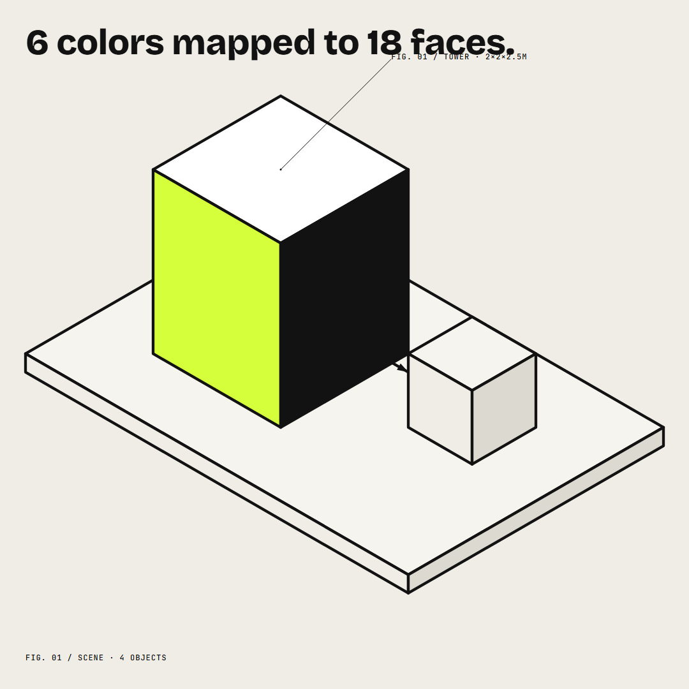

# Blitterbox

Brand kits for AI-made videos. Your style guide becomes isometric components your agent can animate.

## Quickstart

1. Install and register the MCP server (see configs below).
2. Tell your agent to call `get_brand`, then `compose_scene`, then `render`.
3. Open the file path `render` returns.

## Claude Code

```
claude mcp add blitterbox -- npx blitterbox
```

## Cursor

Add to `.cursor/mcp.json` (or your global `~/.cursor/mcp.json`):

```json
{
  "mcpServers": {
    "blitterbox": {
      "command": "npx",
      "args": ["blitterbox"]
    }
  }
}
```

## Tools

### `get_brand`

No input. Returns the resolved design tokens and a summary of the brand rules. Call this first.

```json
{}
```

### `compose_scene`

Input is a scene (see `examples/tower.json`). Validates every brand rule and returns every error found, not just the first. Saves valid scenes to `out/scenes/`.

```json
{
  "format": "square",
  "durationSec": 4,
  "background": "vellum",
  "title": "6 colors mapped to 18 faces.",
  "objects": [
    { "id": "ground", "type": "platform", "at": [0, 0, 0], "size": [6, 4] },
    { "id": "tower", "type": "block", "at": [1, 1, 0.25], "size": [2, 2, 2.5], "faces": "brand" }
  ],
  "callouts": [{ "text": "FIG. 01 / TOWER", "anchor": "tower" }]
}
```

### `render`

Input is a `sceneId` from `compose_scene` and a `kind`. Returns the absolute file path of the render.

```json
{ "sceneId": "...", "kind": "png" }
```

`kind` is `"png"` (social graphic, the frame at the end of the animation) or `"mp4"` (the full clip).

## Using your own brand

Replace `tokens.json` at the project root with your own values, in the same shape. `DESIGN.md` documents what each token does and the rules the validator enforces (one highlight color per scene, 0.25-module grid, text length limits). No code changes — every render reads from `tokens.json`.

## License

MIT
